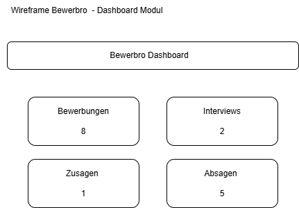
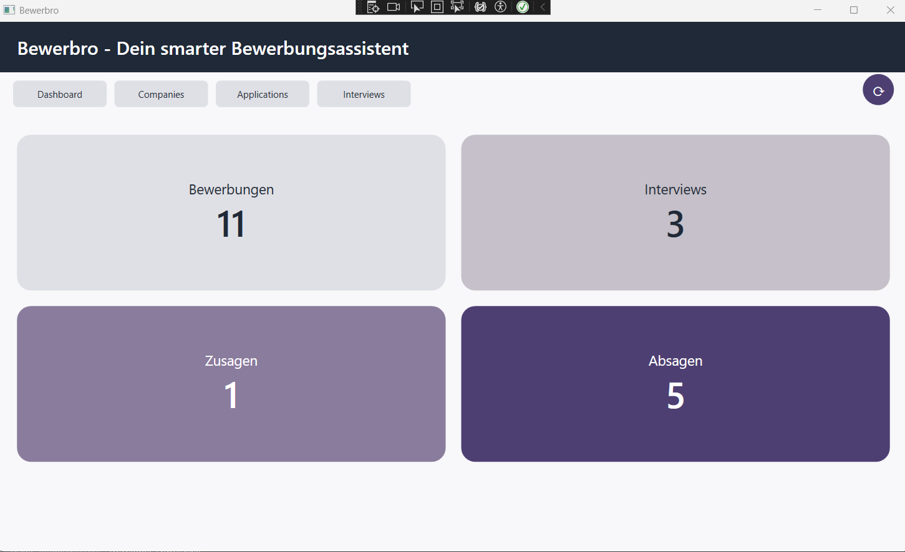
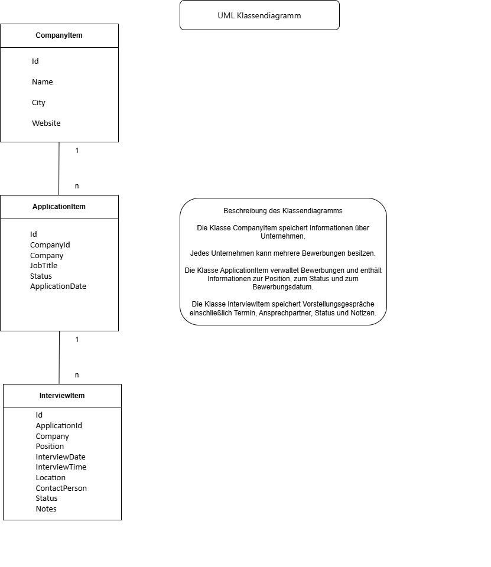
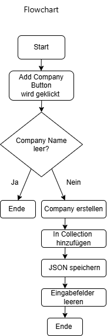
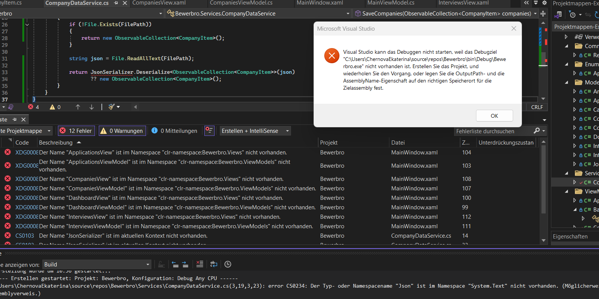

# Bewerbro - Dein smarter Bewerbungsassistent

## 1. Projektbeschreibung

**Bewerbro** ist eine Desktop-Anwendung zur Verwaltung des gesamten Bewerbungsprozesses.

Die Anwendung unterstützt Benutzerinnen und Benutzer dabei,

- Unternehmen zu verwalten
- Bewerbungen zu dokumentieren
- Vorstellungsgespräche zu planen
- wichtige Informationen zentral zu speichern
- den aktuellen Status des Bewerbungsprozesses nachzuverfolgen

Das Projekt wurde mit **C#**, **WPF** und dem **MVVM-Pattern (Model-View-ViewModel)** entwickelt.

---

# 2. Projektziel

Ziel der Anwendung ist die zentrale Verwaltung aller Informationen rund um den Bewerbungsprozess.

Anstatt Informationen in verschiedenen Excel-Dateien, E-Mails oder Notizen zu verwalten, werden sämtliche Daten in einer einzigen Anwendung gepflegt.

Die Software dient als persönlicher Bewerbungsassistent und ermöglicht eine strukturierte Übersicht über:

- Unternehmen
- Bewerbungen
- Vorstellungsgespräche
- Bewerbungsstatus

---

# 3. Verwendete Technologien

## Programmiersprache

```text
C#
```

## Benutzeroberfläche

```text
WPF (Windows Presentation Foundation)
```

## Architektur

```text
MVVM (Model-View-ViewModel)
```

## Datenspeicherung

```text
JSON
```

## Framework

```text
.NET Framework 4.7.2
```

---

# 4. Softwarearchitektur

Die Anwendung basiert auf dem **MVVM-Pattern**.

MVVM trennt die Anwendung in drei Bereiche:

## Model

Enthält die Geschäftsobjekte und Datenstrukturen.

Beispiele:

- Company
- Application
- Interview
- Document
- CareerNote

## View

Enthält ausschließlich die grafische Benutzeroberfläche.

Beispiele:

- DashboardView.xaml
- CompaniesView.xaml
- ApplicationsView.xaml
- InterviewsView.xaml

## ViewModel

Verbindet View und Model.

Aufgaben:

- Datenbereitstellung
- Datenbindung (Binding)
- Ausführung von Commands
- CRUD-Operationen
- Navigation zwischen den Modulen

---

# 5. Projektstruktur

```text
Bewerbro
│
├── Commands
│   └── RelayCommand.cs
│
├── Enums
│   └── ApplicationStatus.cs
│
├── Models
│   ├── Ansprechpartner.cs
│   ├── Application.cs
│   ├── ApplicationItem.cs
│   ├── CareerNote.cs
│   ├── Company.cs
│   ├── CompanyItem.cs
│   ├── Document.cs
│   ├── Interview.cs
│   ├── InterviewItem.cs
│   ├── InterviewQuestion.cs
│   └── JobPosition.cs
│
├── Services
│   ├── ApplicationDataService.cs
│   ├── CompanyDataService.cs
│   └── InterviewDataService.cs
│
├── ViewModels
│   ├── ApplicationsViewModel.cs
│   ├── BaseViewModel.cs
│   ├── CompaniesViewModel.cs
│   ├── DashboardViewModel.cs
│   ├── InterviewsViewModel.cs
│   └── MainViewModel.cs
│
├── Views
│   ├── ApplicationsView.xaml
│   ├── ApplicationsView.xaml.cs
│   ├── CompaniesView.xaml
│   ├── DashboardView.xaml
│   ├── DashboardView.xaml.cs
│   └── InterviewsView.xaml
│
├── App.xaml
├── MainWindow.xaml
├── App.config
└── packages.config
```

---

# 6. Beschreibung der Projektordner

## Commands

### RelayCommand.cs

Implementiert das Interface `ICommand`.

Die Klasse ermöglicht die Ausführung von Aktionen über Buttons innerhalb der Benutzeroberfläche.

Beispiele:

```csharp
AddCompanyCommand
UpdateCompanyCommand
DeleteCompanyCommand
```

---

## Enums

### ApplicationStatus.cs

Definiert mögliche Bewerbungsstatus.

Beispiele:

```text
Applied
Interview
Rejected
Offer
Accepted
```

---

# 7. Models

Die Models repräsentieren die Datenobjekte der Anwendung.

---

## CompanyItem.cs

Speichert Informationen über Unternehmen.

Eigenschaften:

```csharp
Id
Name
City
Website
```

---

## ApplicationItem.cs

Speichert Informationen über Bewerbungen.

Eigenschaften:

```csharp
Id
CompanyId
Company
JobTitle
Status
ApplicationDate
```

---

## InterviewItem.cs

Speichert Informationen über Vorstellungsgespräche.

Eigenschaften:

```csharp
Id
ApplicationId
Company
Position
InterviewDate
InterviewTime
Location
ContactPerson
Status
Notes
```

---

## Company.cs

Domänenmodell für Unternehmensdaten.

---

## Application.cs

Domänenmodell für Bewerbungsdaten.

Enthält zusätzliche Felder wie:

```csharp
ApplyDate
Status
MatchScore
Notes
Documents
Interviews
CareerNotes
```

---

## Interview.cs

Domänenmodell für Interviewdaten.

---

## JobPosition.cs

Repräsentiert offene Stellen bzw. ausgeschriebene Positionen.

---

## Ansprechpartner.cs

Speichert Kontaktpersonen eines Unternehmens.

---

## InterviewQuestion.cs

Speichert Fragen zur Vorbereitung auf Vorstellungsgespräche.

---

## Document.cs

Verwaltet Dokumente wie Lebenslauf und Anschreiben.

---

## CareerNote.cs

Speichert persönliche Notizen zum Bewerbungsprozess.

---

# 8. Services

Die Services übernehmen die Datenpersistenz der Anwendung.

---

## CompanyDataService.cs

Verantwortlich für:

```text
companies.json
```

Methoden:

```csharp
LoadCompanies()
SaveCompanies()
```

Aufgabe:

- Unternehmen laden
- Unternehmen speichern

---

## ApplicationDataService.cs

Verantwortlich für:

```text
applications.json
```

Methoden:

```csharp
LoadApplications()
SaveApplications()
```

Aufgabe:

- Bewerbungen laden
- Bewerbungen speichern

---

## InterviewDataService.cs

Verantwortlich für:

```text
interviews.json
```

Methoden:

```csharp
LoadInterviews()
SaveInterviews()
```

Aufgabe:

- Interviews laden
- Interviews speichern

---

# 9. ViewModels

## BaseViewModel.cs

Basisklasse aller ViewModels.

Implementiert:

```csharp
INotifyPropertyChanged
```

Dadurch werden Änderungen automatisch in der Benutzeroberfläche aktualisiert.

---

## MainViewModel.cs

Zentrale Steuerung der Anwendung.

Aufgaben:

- Navigation
- Modulwechsel
- Verwaltung der aktiven Ansicht

Verwendete Module:

```text
Dashboard
Companies
Applications
Interviews
```

---

## DashboardViewModel.cs

Steuert die Dashboard-Seite.

Angezeigte Kennzahlen:

```text
Bewerbungen
Interviews
Zusagen
Absagen
```

Zusätzlich wurde eine Refresh-Funktion implementiert.

---

## CompaniesViewModel.cs

Verantwortlich für das Unternehmensmanagement.

Implementierte Funktionen:

### Create

Neue Unternehmen anlegen.

### Read

Unternehmen anzeigen.

### Update

Unternehmen bearbeiten.

### Delete

Unternehmen löschen.

### Weitere Funktionen

- automatische ID-Vergabe
- Laden aus JSON
- Speichern in JSON
- Startdaten beim ersten Programmstart

---

## ApplicationsViewModel.cs

Verantwortlich für das Bewerbungsmanagement.

Implementierte Funktionen:

### Create

Neue Bewerbung anlegen.

### Read

Bewerbungen anzeigen.

### Update

Bewerbungen bearbeiten.

### Delete

Bewerbungen löschen.

### Weitere Funktionen

- JSON-Persistenz
- automatische ID-Verwaltung
- Standardbewerbungen beim ersten Start

---

## InterviewsViewModel.cs

Verantwortlich für die Interviewverwaltung.

Implementierte Funktionen:

### Create

Interview anlegen.

### Read

Interview anzeigen.

### Update

Interview bearbeiten.

### Delete

Interview löschen.

### Weitere Funktionen

- Datum und Uhrzeit erfassen
- Ansprechpartner speichern
- Meeting-Link oder Adresse speichern
- Status verwalten
- Notizen speichern
- JSON-Persistenz
- Standardinterviews beim ersten Start

---

# 10. Implementierte Module

## Dashboard

Funktionen:

- Übersicht aller Kennzahlen
- Anzeige von Bewerbungen
- Anzeige von Interviews
- Anzeige von Zusagen
- Anzeige von Absagen
- Refresh-Funktion

---

## Companies

Funktionen:

- Unternehmen anlegen
- Unternehmen bearbeiten
- Unternehmen löschen
- automatische Speicherung
- automatische Wiederherstellung
- Verwaltung von Firmeninformationen

---

## Applications

Funktionen:

- Bewerbungen erstellen
- Bewerbungen bearbeiten
- Bewerbungen löschen
- Bewerbungsstatus speichern
- Bewerbungsdatum verwalten
- JSON-Speicherung

---

## Interviews

Funktionen:

- Interviews verwalten
- Ansprechpartner erfassen
- Terminverwaltung
- Zeitverwaltung
- Meeting-Link speichern
- Notizen erfassen
- CRUD-Funktionalität
- JSON-Speicherung

---

# 11. CRUD-Implementierung

Für die Module

- Companies
- Applications
- Interviews

wurden vollständige CRUD-Operationen umgesetzt.

## Create

Neue Datensätze erstellen.

## Read

Datensätze anzeigen.

## Update

Bestehende Datensätze bearbeiten.

## Delete

Datensätze löschen.

---

# 12. Datenpersistenz

Alle Daten werden lokal als JSON-Dateien gespeichert.

Verwendete Dateien:

```text
companies.json
applications.json
interviews.json
```

Vorteile:

- keine Datenbank erforderlich
- einfache Wartung
- Portabilität
- Daten bleiben nach Programmneustart erhalten

---

# 13. Datenbindung

Das Projekt nutzt WPF Data Binding.

Beispiel:

```xml
Text="{Binding NewCompanyName}"
```

Vorteile:

- automatische Synchronisation
- weniger Code
- saubere Trennung von UI und Logik

---

# 14. Command Pattern

Alle Benutzeraktionen werden über Commands ausgeführt.

Beispiele:

```csharp
AddCompanyCommand
UpdateCompanyCommand
DeleteCompanyCommand

AddApplicationCommand
UpdateApplicationCommand
DeleteApplicationCommand

AddInterviewCommand
UpdateInterviewCommand
DeleteInterviewCommand
```

Vorteile:

- keine Logik im Code-Behind
- bessere MVVM-Unterstützung
- höhere Wartbarkeit

---

# 15. Besondere technische Merkmale

## MVVM

Klare Trennung von:

```text
View
ViewModel
Model
```

---

## JSON-Persistenz

Automatische Datenspeicherung bei Änderungen.

---

## Dynamische Datenbindung

Automatische Aktualisierung der Benutzeroberfläche durch PropertyChanged.

---

## Wiederverwendbare Commands

Zentrale Steuerung von Benutzeraktionen.

---

# 16. Aktueller Projektstatus

## Abgeschlossen

✅ Dashboard-Modul

✅ Companies-Modul

✅ Applications-Modul

✅ Interviews-Modul

✅ MVVM-Architektur

✅ JSON-Persistenz

✅ Navigation

✅ CRUD-Funktionalität

✅ Data Binding

✅ Command Pattern

✅ Modernisiertes UI-Design

---

# 17. Geplante Erweiterungen

- automatische Dashboard-Aktualisierung ohne Refresh
- vollständige Verknüpfung über IDs:
  - Company → Application → Interview
- Dokumentenmanagement
- Interview-Fragenverwaltung
- Karriere-Notizen
- Berichte und Statistiken
- Datenbankintegration

---

# 18. Wireframe

Der folgende Wireframe zeigt den ursprünglichen Entwurf des Dashboard-Moduls vor Beginn der Implementierung.



## Beschreibung

Der Wireframe diente als Grundlage für die Planung der Benutzeroberfläche.

Geplant wurden folgende Bereiche:

- Bewerbungen
- Interviews
- Zusagen
- Absagen

Zusätzlich wurde eine Refresh-Funktion vorgesehen, um Statistiken zu aktualisieren.

## Finale Umsetzung

Die folgende Abbildung zeigt die tatsächlich umgesetzte Version des Dashboards.



### Vergleich zwischen Wireframe und finaler Umsetzung

Die finale Anwendung orientiert sich am ursprünglichen Wireframe.

Folgende Elemente wurden übernommen:

- Dashboard-Überschrift
- Anzeige der Bewerbungen
- Anzeige der Interviews
- Anzeige der Zusagen
- Anzeige der Absagen

Während der Entwicklung wurden zusätzliche Funktionen ergänzt:

- Refresh-Funktion
- JSON-Persistenz
- MVVM-Architektur
- modernes UI-Design
- dynamische Datenbindung


# 19. UML-Klassendiagramm

Das folgende Klassendiagramm zeigt die wichtigsten Entitäten des Projekts sowie deren Beziehungen.



## Beschreibung des Klassendiagramms

Die Klasse CompanyItem speichert Informationen über Unternehmen.

Jedes Unternehmen kann mehrere Bewerbungen besitzen.

Die Klasse ApplicationItem verwaltet Bewerbungen und enthält Informationen zur Position, zum Bewerbungsstatus und zum Bewerbungsdatum.

Die Klasse InterviewItem speichert Vorstellungsgespräche einschließlich Termin, Ansprechpartner, Status und Notizen.

Beziehungen:

- CompanyItem (1) → (n) ApplicationItem
- ApplicationItem (1) → (n) InterviewItem

---

# 20. Flowchart

Der folgende Flowchart zeigt den Ablauf der Funktion "Add Company".



## Beschreibung

Der Benutzer klickt auf die Schaltfläche "Add Company".

Anschließend wird überprüft, ob ein Firmenname eingegeben wurde.

Ist das Feld leer, wird der Vorgang beendet.

Andernfalls wird ein neues Unternehmen erstellt, der Collection hinzugefügt, in der JSON-Datei gespeichert und die Eingabefelder werden zurückgesetzt.

# 21. Zeitplanung

| Datum | Tätigkeit |
|---------|---------|
| 30.10.2026 | Projektidee definiert und Projektstruktur geplant |
| 31.10.2026 | Erstellung der WPF-Navigation und Dashboard-Seite |
| 01.11.2026 | Entwicklung des Companies-Moduls |
| 02.11.2026 | Implementierung der CRUD-Funktionen für Companies |
| 03.11.2026 | Implementierung der JSON-Persistenz für Companies |
| 04.11.2026 | Entwicklung des Applications-Moduls |
| 05.11.2026 | Implementierung von CRUD und JSON-Persistenz für Applications |
| 05.11.2026 | Entwicklung des Interviews-Moduls |
| 05.11.2026 | Implementierung von CRUD und JSON-Persistenz für Interviews |
| 05.11.2026 | Erstellung der Projektdokumentation |
| 05.11.2026 | Erstellung des UML-Klassendiagramms |
| 05.11.2026 | Projektfinalisierung und Tests |

---

# 22. Debugging

Während der Entwicklung des Projekts traten verschiedene technische Probleme auf. Die meisten Fehler konnten mit Hilfe von Visual Studio, der Fehlerliste und dem integrierten Debugger analysiert und behoben werden.



## Debugging Beispiel – JSON-Persistenz

### Problem

Während der Implementierung der JSON-Persistenz konnte die Anwendung nicht gestartet werden. Visual Studio zeigte mehrere Fehlermeldungen an und das Projekt ließ sich nicht erfolgreich kompilieren.


### Fehlermeldung

```text
CS0234:
Der Typ- oder Namespacename "Json"
ist im Namespace "System.Text" nicht vorhanden.
```

### Ursache

Für die Speicherung der Daten sollte die Bibliothek System.Text.Json verwendet werden.
...

---

# 23. Probleme und Lösungen
## Problem 1: Daten gingen nach dem Schließen der Anwendung verloren

Zu Beginn wurden alle Daten ausschließlich im Arbeitsspeicher gespeichert. Nach dem Schließen der Anwendung gingen sämtliche Informationen verloren.

### Lösung

Es wurde eine Persistenzschicht auf Basis von JSON-Dateien implementiert. Die Daten werden nun automatisch in den Dateien companies.json, applications.json und interviews.json gespeichert und beim Start der Anwendung wieder geladen.

---

## Problem 2: Standard-WPF-Design passte nicht zum gewünschten Erscheinungsbild

Die Standard-TextBoxen und Buttons verwendeten die Windows-Standardeinstellungen mit blauer Hervorhebung.

### Lösung

Eigene Styles und ControlTemplates wurden erstellt. Dadurch wurde das Erscheinungsbild an die Farbpalette der Anwendung angepasst.

---

## Problem 3: Verwaltung mehrerer Datenbereiche

Die Anwendung verwaltet Unternehmen, Bewerbungen und Interviews.

### Lösung

Durch den Einsatz des MVVM-Musters wurden die einzelnen Bereiche sauber voneinander getrennt und in eigene Models, Views, ViewModels und Services aufgeteilt.

---

# 24. Verwendete Quellen

## Microsoft Dokumentation

- Microsoft Learn – WPF Documentation
- Microsoft Learn – Data Binding
- Microsoft Learn – ICommand Interface
- Microsoft Learn – INotifyPropertyChanged
- Microsoft Learn – ObservableCollection

## JSON

- Microsoft Learn – System.Text.Json

## Entwicklung und Problemlösung

- Stack Overflow
- GitHub Documentation

## KI-Unterstützung

- Microsoft Copilot
- ChatGPT

## Entwicklungsumgebung

- Microsoft Visual Studio 2022
- Git
- GitHub

---

# 25. Fazit

Bewerbro ist eine moderne WPF-Anwendung zur Verwaltung des gesamten Bewerbungsprozesses.

Durch die Verwendung von C#, WPF, MVVM, Commands, Data Binding und JSON-Persistenz wurde eine strukturierte und erweiterbare Softwarelösung entwickelt.

Die Anwendung ermöglicht die Verwaltung von Unternehmen, Bewerbungen und Vorstellungsgesprächen innerhalb einer zentralen Plattform und unterstützt Anwenderinnen und Anwender dabei, ihren Bewerbungsprozess effizient und übersichtlich zu organisieren.

Während der Umsetzung wurden wichtige Konzepte der Softwareentwicklung praktisch angewendet, insbesondere:

- Objektorientierte Programmierungta Binding
- Command Pattern
- CRUD-Operationen
- JSON-Persistenz
- Git-Versionierung

Durch die modulare Architektur kann die Anwendung zukünftig problemlos erweitert werden. Geplante Erweiterungen umfassen die vollständige Verknüpfung der Entitäten über IDs, Dokumentenverwaltung, Statistikfunktionen sowie eine mögliche Datenbankanbindung.